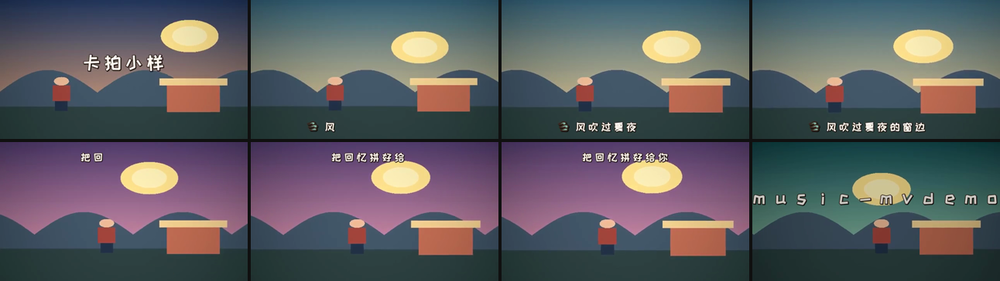

# music-mv

把一首歌做成卡拍点、逐字弹字幕、字幕跟镜头联动的动画 MV。

一套可执行的流水线：**听歌定拍 → 校歌词 → 导演构思与风格锁定 → 定分镜 → 草稿/试制确认 →
出图 → 图生视频 → 卡拍剪时间线 → 逐字弹字幕 → 混音出片 → 自动 QA**。

产出 16:9 / 9:16 / 1:1 的 MP4 + 封面。字幕**逐镜排布**——人物在哪一侧、
画面哪里是空的，字幕就避开哪里，而不是全片固定一行。



> 上图由 `examples/make_demo.py` 自动生成的音频与画面产出，用于验证完整工具链；
> 真实歌曲的画面上限由出图与图生视频模型决定。

## 它解决什么问题

手工做一支 MV，最难的不是出图，是几件容易翻车的事：

1. **字幕不卡拍**。字幕出现时刻是估的，跟音乐对不上，整支片子就显得业余。
2. **中文歌词抄错**。ASR 对演唱几乎不可用，凭记忆写会补全出"更像歌词"的错版本。
3. **字幕和画面打架**。固定一行字幕，遇到特写就压脸，遇到广角又显得悬空。
4. **全片做完才发现方向错了**。没有草稿与试制确认，返工成本等于全片成本。
5. **无法机械验收与复盘**。素材时长、切点、复唱偏移、静帧兜底和成本靠记忆管理。
6. **歌词与画面各说各话**。从预设物件或地点出发，导致机械配图、抽象歌词拼空镜、全片没有情绪递进。

对应方案：每字吸附到拍点网格；歌词走"多源核对 + 段落锚点"；AI 先提出并比较
视觉概念，形成 `director.json` 和逐句覆盖，再展开分镜；字幕位置由分镜表 `place` 决定；
导演草稿与试制两道确认门；manifest + QA + 联系表记录并验证整片。

## 安装

```bash
git clone https://github.com/wangyaruo/music-mv.git
cd music-mv
python -m pip install -r scripts/requirements.txt
```

需要 `ffmpeg`（含 `ass` / `xfade` / `zoompan` / `loudnorm` / `delogo` 滤镜）。
不需要 `ffprobe`——脚本用 `ffmpeg -i` 的 stderr 读时长。

如果系统没有 ffmpeg，可额外安装 `imageio-ffmpeg`，脚本会自动使用它：
`python -m pip install imageio-ffmpeg`。

字体 `assets/fonts/ZCOOLKuaiLe-Regular.ttf` 随仓库附带（SIL OFL 1.1）。

## 先跑零额度 demo

```bash
python examples/make_demo.py --out out/demo
```

不调用任何 AI 服务，自动完成：合成音频与画面 → 分镜与字幕 → 时间线 → 混音 →
封面 → 联系表 → manifest → QA。主要产物：

- `out/demo/成片.mp4`
- `out/demo/out/cover.png`
- `out/demo/out/qa/style_sheet.png` 与 `film_sheet.png`
- `out/demo/out/qa_report.json`

修改任何脚本后，先跑这个 demo，再用于真实歌曲。

## 真实项目快速开始

```bash
# 1. 拍点与风格（风格给用户选，不要自行拍板）
python scripts/beat_sync.py song.mp3 -o out/beats.json
python scripts/style_advisor.py --audio song.mp3 --lyrics lyrics.txt --title "歌名"

# 星露谷式像素另做规格与图像验收；不要使用街机横版规格代替
cp assets/pixel_spec.stardew.example.json out/pixel_spec.json
python scripts/pixel_spec.py check out/pixel_spec.json
# 横版情感叙事改用 pixel_spec.pixelstory.example.json，先写状态变化和道具结果

# 2. 歌词时间轴（先人工核对歌词；可用 ASR 只生成段落边界草稿）
# 可选：python -m pip install -r scripts/requirements-asr.txt
# python scripts/asr_segments.py --audio song.mp3 --lyrics lyrics.txt -o out/groups.json
python scripts/lyrics_timing.py --groups out/groups.json --beats out/beats.json \
    -o out/lines_timing.json

# 3. 复唱校验：按实际歌曲结构给两遍句号，不要对半猜
python scripts/check_repeat.py --timing out/lines_timing.json \
    --first 1-18 --second 19-36

# 4. AI 导演构思：先比较视觉概念，再完成逐句覆盖，不要求用户预选物件
python scripts/director_plan.py scaffold --lyrics lyrics.txt --title "歌名" -o out/director.json
# 由 AI 根据歌曲填写 director.json 后：
python scripts/director_plan.py check out/director.json --lyrics lyrics.txt
python scripts/director_plan.py review out/director.json --lyrics lyrics.txt -o out/director.md

# 5. 从导演总纲展开 out/shots.tsv，然后生成导演草稿与逐镜生产清单
python scripts/manifest.py init --shots out/shots.tsv --audio song.mp3 \
    --style cel --width 1920 --height 1080 -o out/manifest.json
# 先确认 out/storyboard.md，再试制 2-3 镜，最后批量生成 clips/v01.mp4 ...

# 6. 字幕条目与逐字 ASS
python scripts/build_lines.py --timing out/lines_timing.json --shots out/shots.tsv \
    --cards out/cards.json -o out/lines.json
python scripts/make_subs.py --lines out/lines.json --beats out/beats.json \
    --motifs --width 1920 --height 1080 -o out/subs.ass

# 7. 卡拍拼接：自动读音频时长、探测素材、补帧裁齐、写入验收报告
python scripts/build_base.py --shots out/shots.tsv --clips-dir clips \
    --beats out/beats.json --audio song.mp3 --fade 0.45 \
    --width 1920 --height 1080 --fill-ids s02,s10,s04,s27 -o out/base.mp4

# 8. 合成与封面（delogo 默认关闭，确认水印坐标后再显式开启）
python scripts/mix_final.py --base out/base.mp4 --audio song.mp3 \
    --subs out/subs.ass --out "成片.mp4"
python scripts/make_cover.py --image images/c16/s12.png \
    --title "歌名" --artist "歌手" --out out/cover.png

# 9. 自动 QA + 视觉联系表 + 成本/兜底清单
python scripts/director_plan.py check out/director.json --lyrics lyrics.txt
python scripts/qa_check.py --project . --audio song.mp3 --final "成片.mp4"
python scripts/contact_sheet.py --images 'images/c16/s*.png' \
    --out out/qa/style_sheet.png --cols 7
python scripts/contact_sheet.py --video "成片.mp4" \
    --out out/qa/film_sheet.png --count 12 --cols 4
python scripts/manifest.py report -m out/manifest.json
```

竖屏把 `--width 1920 --height 1080` 改为 `--width 1080 --height 1920`，
并重新生成分镜、基片、ASS 与封面；不要直接拉伸横屏字幕。

## 内置风格库

15 种，按 BPM / 发音点密度 / 明亮度 / 歌词意象四项打分排序，取前三给用户选。
选定后 `--pick <id>` 输出单镜时长、叠化与字幕设计建议。

| id | 风格 | BPM | 适合 |
|---|---|---|---|
| `cel` | 日系赛璐璐 | 90–140 | 明亮、有具体场景的青春题材（**推荐默认**） |
| `papercut` | 纸雕拼贴 | 62–96 | 回忆、收集、拼合 |
| `clay` | 黏土定格 | 80–118 | 肢体动作多、情绪外放 |
| `gouache` | 水粉绘本 | 58–92 | 自然意象多、情绪内敛 |
| `ink` | 水墨留白 | 52–82 | 离别、思念、故人 |
| `felt` | 羊毛毡布偶 | 66–100 | 治愈、私密、童年 |
| `flatvector` | 扁平矢量 | 96–150 | 快节奏、城市、舞台 |
| `glass` | 彩绘玻璃 | 70–120 | 副歌爆发、誓言、光 |
| `retroprint` | 复古丝网 | 84–130 | 青春回忆、校园、旧照片 |
| `pixel` | 像素风（街机横版） | 110–160 | 街机、闯关、电子快歌 |
| `pixelstory` | 横版像素剧情游戏 | 58–108 | 情感、回忆、关系距离、道具与结果叙事 |
| `stardew` | 星露谷式田园像素 | 58–108 | 农场、四季、日常劳动、温暖叙事 |
| `glitch` | 赛博故障 | 100–150 | 电子编曲、失真、迷失 |
| `vaporwave` | 蒸汽波 | 80–115 | 怀旧、褪色的夏天 |
| `pencil` | 彩铅手绘 | 65–100 | 日记感、民谣、同桌 |

注意：风格库负责推荐与节奏参数；`make_subs.py` 当前实际实现 `cut` / `box`
两种字幕主题。其他风格的字幕描述是设计建议，不是已经完成的 13 套主题。

## 脚本

| 脚本 | 作用 |
|---|---|
| `beat_sync.py` | BPM 与拍点网格（频谱通量 + 自相关 + 相位搜索） |
| `song_structure.py` | 段落边界与分镜数量参考（**只作参考**，长副歌会误判） |
| `style_advisor.py` | 按 tempo / 能量 / 亮度 / 歌词意象推荐 3 套画风 |
| `director_plan.py` | 导演结构脚手架、情绪/节奏/母题/转场与逐句覆盖校验、用户审阅稿 |
| `pixel_spec.py` | 星露谷/横版像素剧情规格、真实 sprite 轮廓与整数缩放校验 |
| `lyrics_timing.py` | 歌词分组 → 逐句时间轴（锚点 + 字数比例 + 拍点吸附） |
| `asr_segments.py` | 可选 faster-whisper 分段，只取边界、不采用识别文本 |
| `check_repeat.py` | 复唱两遍的恒定偏移校验，可生成修正版时间轴 |
| `build_lines.py` | 把字幕位置绑到镜头上，合并片头尾标题卡 |
| `make_subs.py` | 逐字弹 ASS；支持多分辨率重排版与真实出字指标 |
| `motifs.py` | ASS 矢量装饰图案与歌词意象匹配 |
| `make_timeline.py` | xfade 滤镜；切点吸附、异常镜头拦截、慢放上限、末尾裁齐 |
| `build_base.py` | 自动读音频与素材时长、渲染基片、写时长验收报告 |
| `mix_final.py` | 字幕 + 调色 + 可选去水印 + 响度标准化 + 首尾淡化 |
| `manifest.py` | 导演草稿、逐镜提示词/来源/成本/状态、交付清单 |
| `qa_check.py` | 时长、切点、字幕重叠、素材缺失、响度等自动验收 |
| `contact_sheet.py` | 分镜风格总览与成片等距抽帧联系表 |
| `make_cover.py` | 从分镜图或成片抽帧生成横竖屏封面 |

## 文档

- [SKILL.md](SKILL.md) —— 完整工作流与每个环节的判断依据
- [references/director-storytelling.md](references/director-storytelling.md) —— AI 导演构思、抽象歌词表达、视觉母题、镜头衔接与逐句覆盖
- [references/production-playbook.md](references/production-playbook.md) —— 两道确认门、manifest、QA、多画幅与交付纪律
- [references/pipeline.md](references/pipeline.md) —— 数据结构、时间线数学、成本模型、真实案例复盘
- [references/visual-style.md](references/visual-style.md) —— 画风锁定：从设计稿到 40 镜不跑偏
- [references/stardew-pixel.md](references/stardew-pixel.md) —— 星露谷式投影、tile/sprite、动作、遮挡、光照与图像级验收
- [references/pixel-narrative.md](references/pixel-narrative.md) —— 横版像素剧情、状态通道、场景复用、距离构图与道具/结算闭环
- [references/ui-narrative.md](references/ui-narrative.md) —— 游戏/软件界面装置叙事：用量化机制承载抽象歌词
- [references/procedural-pixel.md](references/procedural-pixel.md) —— 纯代码像素渲染：不出图、零成本，四层结构、五个必踩的坑与可跑骨架
- [references/lyrics-accuracy.md](references/lyrics-accuracy.md) —— 歌词校对，以及用 OCR 读原片歌词做时间轴校准
- [references/subtitle-styling.md](references/subtitle-styling.md) —— ASS 版式、逐字节奏（`REVEAL`）、踩坑
- [references/ffmpeg-recipes.md](references/ffmpeg-recipes.md) —— 滤镜配方
- [references/troubleshooting.md](references/troubleshooting.md) —— 现象 / 原因 / 处理
- [UPGRADE.md](UPGRADE.md) —— 本次增强的改动与验证记录

## 示例数据与测试

`assets/` 下有真实数据可对照，并保留了一个"第二遍漂移 2.783s"的回归样本；
修正版 `lines_timing.fixed.example.json` 将偏差降至 0.074s。用法与注意事项见
[assets/README.md](assets/README.md)。

```bash
python -m unittest discover -s tests -v
python examples/make_demo.py --out out/demo
```

GitHub Actions 会执行编译检查、单元测试和完整 demo。

## 已知限制

- **ASR 对演唱中的中文歌词基本不可用**。工具链的前提是"人工写准歌词，只用 ASR
  的段落边界"。ASR 工具由调用方选择，不要试图调参修好演唱文本识别。
- `beat_sync.py` 的自相关 BPM 在部分歌曲上可能出现半速/倍速；拍点是全链路地基，
  继续生产前必须人工核对，必要时修正 `beats.json`。
- `song_structure.py` 会把长副歌判成一整段，分镜数量需要人工定。
- 图生视频单段上限约 6 秒；默认慢放超过 1.3 倍会中止，需拆镜或更换素材。
- `stardew` 不能只靠提示词或像素化滤镜实现；AI 构图和姿态候选仍需在原生网格中清理、配准并通过 sprite/缩放审计。
- `pixelstory` 不能只靠 HUD 和街景复用；每镜必须有可见状态变化，关键手势和道具结果还需真实姿态与构图证据。
- `director_plan.py check` 只检查导演结构和歌词覆盖，不能证明语义理解、审美或最终画面质量；必须保留导演评审与试制确认。
- 逐字字幕需要 `libass` 支持内联标签，极老的 ffmpeg 可能有问题。
- 示例 `shots.example.tsv` 保留了早期黏土版案例，仅用于数据结构对照；
  新项目的提示词必须遵循 `visual-style.md` 的三段式，不要照抄旧画风。

## 版权与合规

音乐、歌词与素材的授权由使用者负责。本项目只提供技术流程，不授予任何内容权利。
OCR 校准应限定于自有或已获授权的素材。部分 AI 平台要求保留生成标识，
使用 `delogo` 前必须确认所用平台的服务条款；交付时不得隐瞒静帧替代或素材复用。

## 许可

代码 MIT。字体 ZCOOL KuaiLe 为 SIL Open Font License 1.1（见
`assets/fonts/OFL.txt`）。
